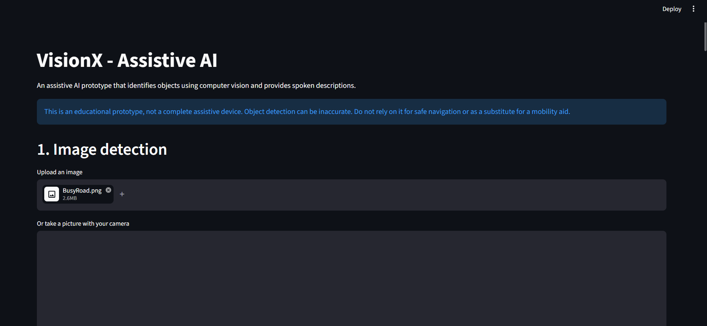
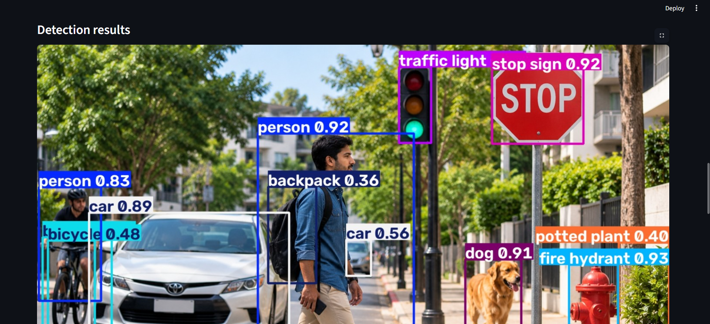
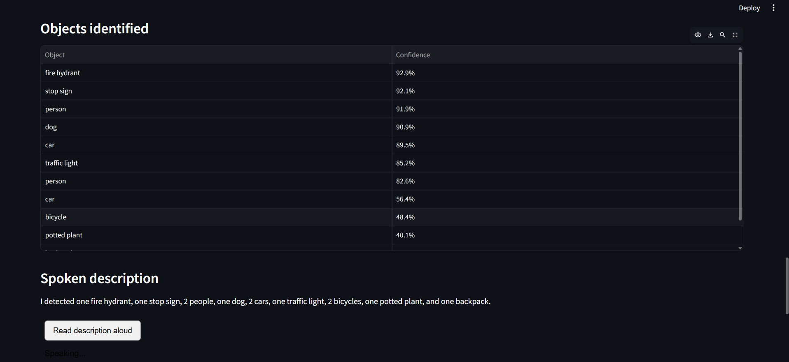
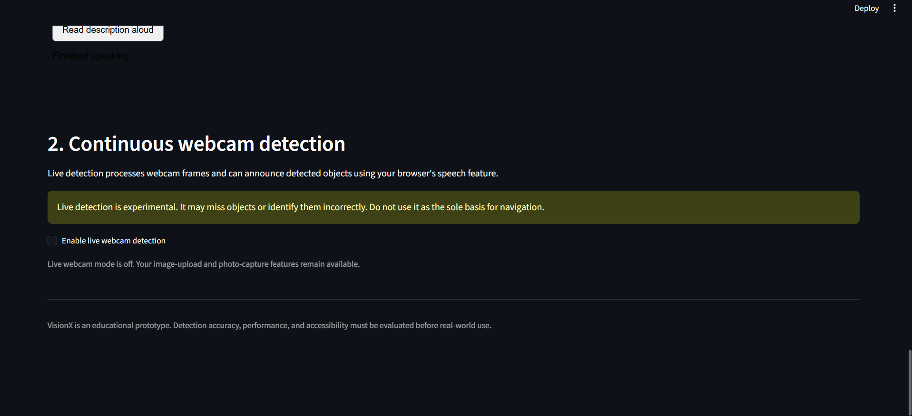

# VisionX – Assistive AI for the Visually Impaired

VisionX is an assistive AI project developed in October 2025 as an academic project. It explores how computer vision and spoken feedback can help people with visual impairments identify objects and understand some of the visual information around them.

The application uses a pretrained YOLO model to detect objects in images and live webcam video. It displays detected objects with bounding boxes and confidence scores and can read descriptions aloud through the browser.

## The Problem

People with visual impairments can face difficulties identifying objects and understanding their surroundings. VisionX explores how computer vision and audio feedback can make information about detected objects more accessible.

## The Solution

VisionX combines a YOLO object-detection model with a Streamlit web application. Users can upload an image, capture a photo using their camera, or start live webcam detection. The application identifies supported objects, displays the results, and provides spoken descriptions or live detection announcements.

## Features

- Upload an image for object detection.
- Capture a photo using the camera.
- Detect supported objects using YOLO.
- View object labels and bounding boxes.
- Review detection confidence scores.
- Generate descriptions based on detected objects.
- Listen to spoken descriptions through the browser.
- Process live webcam video.
- Enable automatic spoken announcements during live detection.
- Run the application locally through Streamlit.

## Screenshots

### Main application



### Object detection



### Detection results



### Live webcam detection



## Technology Stack

| Technology | Purpose |
|---|---|
| Python | Application logic |
| Streamlit | Web interface |
| Ultralytics YOLO | Object detection |
| OpenCV | Computer-vision and image/video processing support |
| Pillow | Image handling |
| Streamlit WebRTC | Live webcam streaming |
| PyAV | Video-frame handling |
| Browser Speech Synthesis API | Spoken descriptions and announcements |

## How It Works

1. The user uploads an image, captures a camera photo, or starts live webcam detection.
2. The YOLO model processes the image or video frames.
3. The application identifies supported objects and displays their labels, bounding boxes, and confidence scores.
4. VisionX generates a short description based on the detected objects.
5. The browser can read the description aloud or announce detections during live processing.

Camera access and browser speech permissions may be required for these features.

## Project Structure

```text
visionx-assistive-ai/
├── app.py
├── requirements.txt
├── README.md
├── .gitignore
└── docs/
    ├── sample-images/
    │   ├── BusyRoad.png
    │   └── StreetScene.png
    └── screenshots/
        ├── DetectionResults.png
        ├── LiveDetection.png
        ├── ObjectDetection.png
        └── VisionXHome.png
```

**Important files and folders**

- `app.py` — Contains the main application, object detection, and speech features.
- `requirements.txt` — Lists the Python packages required to run the application.
- `.gitignore` — Excludes local files such as virtual environments, downloaded model weights, and backups.
- `docs/sample-images/` — Contains example images for trying object detection.
- `docs/screenshots/` — Contains screenshots of the application.

The `.venv/` folder, Python cache files, local backups, and downloaded model weights are not included in the tracked project files.

## Getting Started

### Requirements

- Python and pip
- A compatible web browser
- Internet access to install dependencies and obtain the model weights
- A webcam for camera capture and live detection

### 1. Clone the repository

```bash
git clone https://github.com/abdulfadhil/visionx-assistive-ai.git
cd visionx-assistive-ai
```

### 2. Create a virtual environment

```bash
python -m venv .venv
```

### 3. Install dependencies

On Windows, run:

```powershell
.\.venv\Scripts\python.exe -m pip install -r requirements.txt
```

### 4. Add the model weights

VisionX requires the `yolo11n.pt` model file in the project root. This file is not included in the repository by default. Obtain the appropriate pretrained weights from a trusted source and follow the applicable model licensing terms.

### 5. Run the application

On Windows, run:

```powershell
.\.venv\Scripts\python.exe -m streamlit run app.py
```

Open the local URL displayed in the terminal, usually `http://localhost:8501`.

## Sample Images

Two example images are provided for trying image detection:

- `docs/sample-images/StreetScene.png`
- `docs/sample-images/BusyRoad.png`

The results depend on the image and the objects detected by the model.

## Limitations

VisionX may miss objects or identify them incorrectly. Confidence scores do not guarantee that a detection is correct. Spoken descriptions may not capture every detail of a scene, and live performance depends on the computer, camera, and browser.

## Future Improvements

Possible future improvements include:

- Improving detection accuracy, speed, and spoken descriptions.
- Exploring voice commands to request information about specific objects.
- Investigating distance estimation and spatial audio.
- Exploring integration with assistive hardware, wearable devices, or smart glasses, including XR platforms such as Meta glasses.
- Improving accessibility and evaluating the application through appropriate testing.

These are possible future directions, not features currently implemented in the application.
